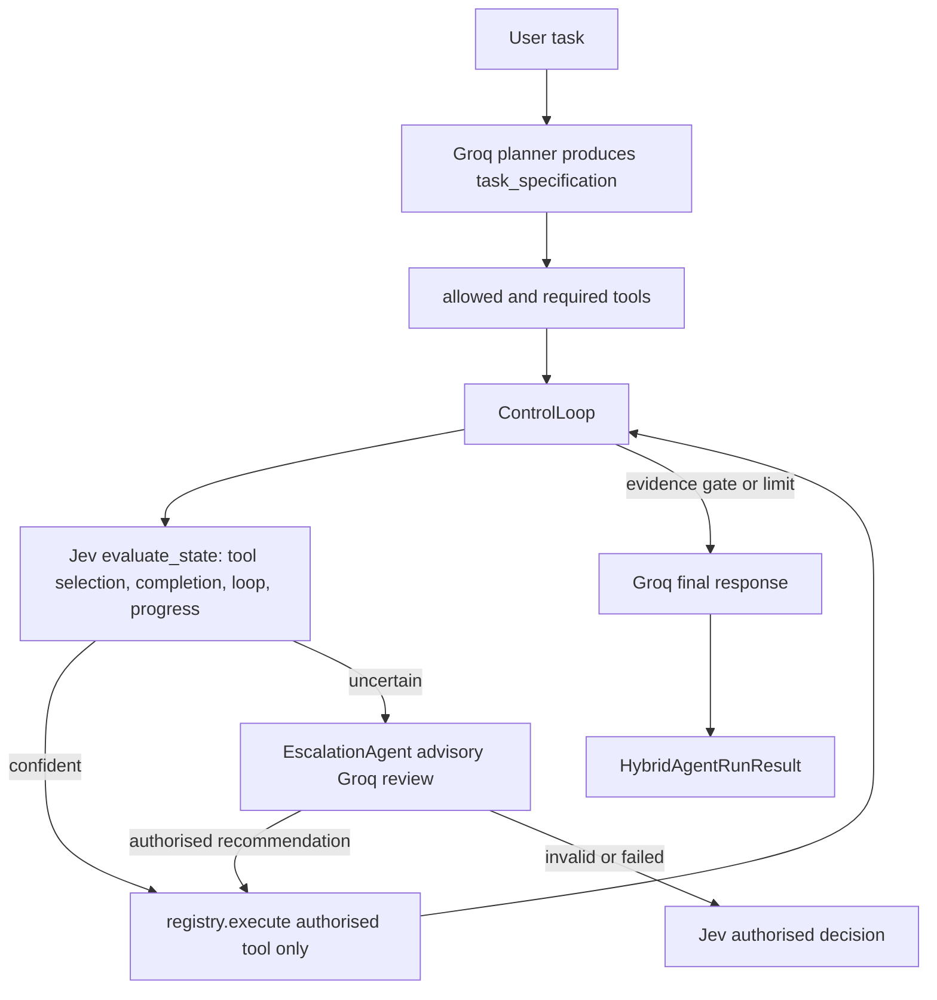

# Fast Decisions, Slow Thoughts

A hybrid LLM + System One (Jev) architecture for cost-efficient AI agents
— an experimental research prototype for a final-year project.

## Overview

Conventional agents delegate **every** control decision — planning, tool
selection, argument generation, completion detection, loop detection — to a
single large language model. That is expensive in tokens and latency, and
LLM control decisions are not always reliable.

This project investigates whether splitting control responsibilities
between two components produces cheaper, more reliable agents:

- **System Two — Groq LLM** (`openai/gpt-oss-120b`): reasoning, natural
  language, tool argument generation, final response, and advisory reviews.
- **System One — Jev** (TypeSafe API, `jev-latest` → `jev-1.14.0`): fast
  tool selection, confidence estimation, progress, completion probability
  and loop detection.

## Research motivation

Customer-support agents repeatedly make small control decisions ("which
tool next?", "are we done?", "is this looping?"). Asking a large model each
time is costly; asking a specialised decision model may be cheaper and
faster, but its confidence judgements must be validated. The research
problem is whether a System One controller, with uncertainty-aware
escalation to a System Two model, matches LLM-only reliability at lower
cost.

## Objectives and contributions

1. A three-mode architecture sharing one tool registry and one benchmark
   dataset, so modes are directly comparable.
2. Uncertainty-driven escalation where the LLM is advisory only — the
   controller keeps final authority and every safeguard still applies.
3. Evidence-based verification: completion requires valid execution
   evidence from every required tool, never a model's probability alone.
4. A benchmark framework with provider-distinguishable metrics,
   independent outcome verification and append-only logging.
5. A Streamlit research dashboard that keeps mocked and live execution
   strictly separate.

## Architecture



## Experimental modes

| Mode | Name | Groq (System Two) | Jev (System One) |
|---|---|---|---|
| **A** | LLM-only | planning, tool selection, arguments, completion, final response | — |
| **B** | LLM + Jev | planning, arguments, final response | tool selection, completion, loop detection, progress |
| **C** | Hybrid with escalation | as B, plus advisory review of uncertain Jev decisions | as B, escalates when uncertain |

Mode C triggers: selected-tool probability ≤ `TOOL_CONFIDENCE_THRESHOLD`
(default 0.60), or completion probability in
`[COMPLETION_AMBIGUITY_LOWER, COMPLETION_AMBIGUITY_UPPER)` (default
[0.50, 0.70)). Both are provisional pending calibration.

## Technology stack

Python 3.11+ · Groq API · TypeSafe Jev API · Streamlit · Pandas ·
NumPy · Plotly · pytest · python-dotenv · typesafe-sdk

## Repository structure

```
├── app.py                 Streamlit dashboard (presentation layer)
├── agents/                Mode A baseline, Mode B/C control loop, escalation
├── models/                Groq LLM client, Jev client
├── tools/                 3 simulated support tools + registry
├── evaluation/            independent verifier, metrics, append-only logger
├── config/settings.py     .env loading + validation
├── data/                  knowledge base + 10-task benchmark dataset
├── experiments/           recorded results (append-only)
├── scripts/               run/benchmark/demo/smoke-test entry points
├── tests/                 190 mocked tests
├── docs/                  ARCHITECTURE, EXPERIMENTS, DEVELOPMENT, REPRODUCIBILITY
└── documentations/        historical phase notes (phases/ 01–06) + risk analysis
```

## Installation

```bash
python -m venv venv
venv\Scripts\activate            # Windows
pip install -r requirements.txt
```

## Configuration

Copy `.env.example` to `.env` and fill in keys. `.env` is gitignored.

| Key | Default | Needed for |
|---|---|---|
| `GROQ_API_KEY` | — | live runs |
| `GROQ_MODEL` | `openai/gpt-oss-120b` | live runs |
| `TYPESAFE_API_KEY` | — | live runs |
| `JEV_MODEL` | `jev-latest` | live runs |
| `GROQ_TEMPERATURE` / `GROQ_MAX_COMPLETION_TOKENS` / `GROQ_TIMEOUT` | 0.2 / 1024 / 60 | live runs |
| `TOOL_CONFIDENCE_THRESHOLD` | 0.60 | Mode C (provisional) |
| `COMPLETION_AMBIGUITY_LOWER` / `_UPPER` | 0.50 / 0.70 | Mode C (provisional) |

Mocked execution needs no keys.

## Running

Dashboard (main research demonstration):

```bash
streamlit run app.py        # http://localhost:8501
```

Single tasks (live APIs, require keys):

```bash
python scripts/run_baseline.py --task "Check the current VPN service status."
python scripts/run_hybrid.py --task "Check the current VPN service status."
python scripts/demo_mode_c.py          # mocked, offline, free
```

## Tests

```bash
python -m pytest tests/ -v
```

All 190 tests are mocked; no test contacts a live API.

## Evaluation and benchmarking

`scripts/run_benchmark.py` compares Modes A/B/C on the same 10-task
dataset with the same deterministic verification criteria:

```bash
python scripts/run_benchmark.py --mode all --repetitions 1            # mocked, free
python scripts/run_benchmark.py --mode B --repetitions 2 --quiet
python scripts/run_benchmark.py --mode A --live --max-live-runs 3 --yes   # live, opt-in
python scripts/run_benchmark.py --threshold-analysis
```

Metrics are provider-distinguishable (Groq vs Jev tokens), latency
(per provider, tool, total), iterations, tool calls, tool failures,
escalation counts/frequency, and the independently verified outcome
(`verified` / `failed` / `unverifiable`) kept separate from the agent's
self-reported success. Missing values stay `None`; nothing is invented.
See [docs/EXPERIMENTS.md](docs/EXPERIMENTS.md).

### Cost accounting (Phase 11)

Every run also records estimated economic cost. Pricing is centralized
in `config/pricing.py` (Groq GPT-OSS 120B: $0.15/$0.60 per 1M tokens;
Jev 1.14.0: $0.042/$0.00 per 1M tokens) and is never hardcoded elsewhere.
Each record separates **estimated equivalent cost** (reference pricing ×
recorded tokens) from **actual expenditure** (amount charged, where
known; Groq free tier = $0). Historical rows keep missing cost fields as
missing; pricing changes create a new version rather than rewriting
history. See [docs/EXPERIMENTS.md](docs/EXPERIMENTS.md#41-economic-cost-metrics-phase-11).

## Reproducibility

`python -m pytest tests/ -v` → 190 passed (mocked). Mocked benchmark
runs are free and offline; live runs are opt-in with a hard budget.
Recorded outputs live in `experiments/` (append-only). Full instructions:
[docs/REPRODUCIBILITY.md](docs/REPRODUCIBILITY.md).

## Limitations

- Prototype: 10 simulated tasks, no external services, in-memory tickets.
- Mode C thresholds are provisional, not calibrated; the mocked dataset
  never exercises escalation (all Jev confidences 0.95).
- No unit coverage for the API clients; live escalation branches not yet
  exercised; Jev requests have no timeout.
- `experiments/benchmark_results.*` mixes two code versions of the mocked
  constants — use `experiments/demo_mocked/` for clean analysis.

See [docs/EXPERIMENTS.md](docs/EXPERIMENTS.md#7-experimental-limitations)
and [docs/REPRODUCIBILITY.md](docs/REPRODUCIBILITY.md#8-external-api-dependencies-and-limitations).

## Future research

Calibrate escalation thresholds on live data; add unit tests for the API
clients; collect a live benchmark campaign (including a live Mode C row);
measure confidence calibration; extend the dataset and add cost-per-
successful-task analysis.

## Documentation

- [docs/ARCHITECTURE.md](docs/ARCHITECTURE.md) — components, flows, safeguards
- [docs/EXPERIMENTS.md](docs/EXPERIMENTS.md) — research questions, modes, metrics
- [docs/DEVELOPMENT.md](docs/DEVELOPMENT.md) — setup, testing, extending
- [docs/REPRODUCIBILITY.md](docs/REPRODUCIBILITY.md) — reproducing experiments
- `documentations/` — historical phase notes (`phases/` 01–06) and the risk analysis (`risks.md`)

## License

No license file is present; the repository is proprietary FYP work.
